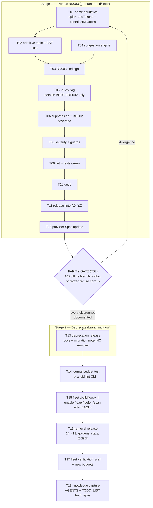

# SUPERB Plan: strong-id Migration → `brandid-lint` BD003

**Date:** 2026-10-11 04:16
**Author:** Crush (planning session)
**Scope:** Port `branching-flow/pkg/strongid` into `go-branded-id/linter` as opt-in rule **BD003**, then deprecate and remove it from branching-flow — merged end-state of both prior analyses.
**Inputs:**
- `docs/status/2026-10-11_02-10_strong-id-linter-migration-analysis.md` (this repo — evidence + technical calls)
- `~/projects/branching-flow/docs/planning/2026-10-11_strongid-migration-to-go-branded-id.md` (sequencing craft — parity gate, lockstep ordering)
- `docs/status/2026-10-09_05-22_brandid-lint-fleet-rollout-all-projects.md` (fleet rollout lessons)

---

## Decision (merged verdict)

**Port as BD003, staged: port → parity gate → release → deprecate in branching-flow → fleet re-point → remove.**

Non-negotiable calls (from the comparison session, evidence-verified):

| Call | Decision | Why |
| --- | --- | --- |
| Default rule set | **BD001+BD002 only; BD003 opt-in via `-rules`** | brandid-lint runs fleet-wide via BuildFlow; webphone skipped branching-flow *over* STRONG_ID x2, DiscordSync caps at 2200. Default-on = hostile flood of repos that deliberately silenced strong-id. |
| Repair for BD003 | **Detect-only. Repair stays BD001-only.** | A BD003 "fix" means rewriting the param type + every call site — a codemod, not a lint fix. Inserting only the suggested type definition does not clear the finding. |
| Suppression | **`//brandid-lint:ignore(BD003) <reason>`, no nolint bridging** | Verified: **zero** `//nolint:branching-flow:strong-id` directives exist outside branching-flow. Repos gate via `.buildflow.yml`. Nothing to translate in source. |
| Dependencies | **Port is stdlib-only; no new module deps** | `linter/` must never import the root module or branching-flow. astutil/core/primitivetype/text/finding internals get re-implemented minimal. |
| Lockstep | **linter release strictly BEFORE branching-flow removal** | Otherwise an ecosystem coverage gap. |
| Parity gate | **Mandatory A/B diff before removal** | Both linters on the same fixture corpus; every divergence needs a documented accept. |

---

## Pareto Breakdown

### The 1% that deliver 51%

**The detection core, running behind a flag.** Port `containsIDPattern` + `splitNameTokens` (the name heuristics — the detector's brain), the primitive-type table, and the param/return/field AST scan into `linter/`, emitting BD003 findings — gated behind `-rules` so nothing changes for anyone by default. After this, the rule exists, is testable, and is usable by anyone who opts in.

### The 4% that deliver 64%

**Make the findings actionable and trustworthy.** Add the suggestion engine (`extractIDRoot`, `suggestIDTypeName`, `suggestIDBrand`, before/after code, type definition), suppression integration (BD003 joins the known-rule set; BD002 auto-polices broken directives), and the **parity gate** (A/B diff against branching-flow strong-id on a fixture corpus).

### The 20% that deliver 80%

**Ship it and start the handover.** Full lint/test compliance, docs (doc.go semantic split: BD001/BD002 = brand hygiene, BD003 = brand adoption; website page), release `linter/vX.Y.Z`, provider Spec update, and the branching-flow **deprecation** release (docs + migration note only — no removal yet).

### The other 80% (to reach 100%)

The removal and the fleet: branching-flow removal release (14→13 linters, goldens, stats, LinterKey, CLI subcommand, toolsdk description), journal's `strong_id_budget_test.go` CLI invocation migration, fleet `.buildflow.yml` re-pointing (webphone, DiscordSync, go-business-rules BDD gate), fleet verification scan, AGENTS/TODO_LIST knowledge capture in both repos.

---

## Comprehensive Plan — Medium Granularity (30–100 min tasks)

Sorted by importance / impact / effort / customer-value (tier order = impact order; within tier, dependency order).

| #  | Task                                                                                                       | Tier | Est (min) | Impact | Customer value                                                                                                |
| -- | ---------------------------------------------------------------------------------------------------------- | ---- | --------- | ------ | ------------------------------------------------------------------------------------------------------------- |
| T01 | Port name heuristics: `splitNameTokens`, `containsIDPattern` + table-driven tests                          | 1%   | 90        | High   | The detector's brain — every finding depends on it                                                            |
| T02 | Primitive-type table + AST scan (params, named returns, struct fields, interface-method skip) on `walkGoFiles` | 1%   | 100       | High   | The actual detection; reuses existing parse-once plumbing                                                    |
| T03 | BD003 finding construction (advisory severity, Range via DeclEndLine, Snippet)                             | 1%   | 45        | High   | Findings exist in go-finding shape                                                                            |
| T04 | Port suggestion engine: `extractIDRoot`, `suggestIDTypeName`, `suggestIDBrand`, before/after code strings  | 4%   | 90        | High   | Actionable output — the adoption pitch in every finding                                                      |
| T05 | `-rules` CLI flag + rule-set plumbing through `DetectPath` (default BD001+BD002; unknown rule = error)     | 4%   | 60        | High   | Zero fleet blast radius on day one                                                                            |
| T06 | Suppression: BD003 in known-rule set; `ignore(BD003)` placement tests; BD002 covers broken directives     | 4%   | 60        | High   | Triage path exists; directive integrity checked                                                              |
| T07 | Parity gate: run both linters on fixture corpus, normalize, diff, document every divergence               | 4%   | 90        | High   | Behavior-drift proof — mandatory before any removal                                                           |
| T08 | Port severity ranking + edge guards (`determineStrongIDSeverity`, String/Error skip)                       | 20%  | 45        | Med    | Message fidelity vs old findings                                                                              |
| T09 | Lint + fmt + full module tests green (`cd linter && go test ./...`, `nix run .#lint`)                      | 20%  | 30        | Med    | Repo quality bar (exhaustruct_v5, paralleltest, wrapcheck)                                                    |
| T10 | Docs: linter doc.go semantic split (hygiene vs adoption) + website docs page + suppression examples        | 20%  | 45        | Med    | The one-screen story: BD003 adopt → BD001 name → Repair                                                       |
| T11 | Release `linter/vX.Y.Z`: CHANGELOG section cut, tag (annotated+signed), push, website changelog + deploy    | 20%  | 60        | High   | Shipping; enables everything downstream                                                                      |
| T12 | Provider Spec description update (BD003 opt-in semantics) + provider test                                  | 20%  | 30        | Med    | BuildFlow contract stays truthful                                                                            |
| T13 | branching-flow deprecation release: CLI help/docs note, CHANGELOG, "Rule-ID / Baseline Migration" section  | tail | 90        | Med    | Ecosystem hears the handover before anything breaks                                                          |
| T14 | journal `strong_id_budget_test.go` → `brandid-lint -rules BD003 --format finding` invocation               | tail | 30        | Med    | The one downstream test that shells out to the old CLI                                                       |
| T15 | Fleet `.buildflow.yml` re-pointing: webphone, DiscordSync, go-business-rules BDD gate (scan after EACH)    | tail | 100       | Med    | Ecosystem continuity; per-repo deliberate enable/cap decision                                                |
| T16 | branching-flow removal release: delete pkg/strongid + CLI + LinterKey + stats + goldens + toolsdk (14→13)  | tail | 100       | Med    | The diet; single source of truth achieved                                                                    |
| T17 | Fleet BD003 verification scan + triage report (counts vs old STRONG_ID, budgets recorded)                  | tail | 60        | Med    | Prove continuity; new baseline                                                                               |
| T18 | Knowledge capture: AGENTS.md both repos, TODO_LIST harvest, archive/cross-link planning docs               | tail | 45        | Med    | Future sessions start informed                                                                               |

**Total: ~19.7 h.** Critical path: T01 → T02 → T03 → T05 → T07 → T11 → T13 → T15 → T16 → T17.

---

## Fine Breakdown — Micro Tasks (≤ 12 min each)

Sorted by tier (impact), then execution order within each parent task.

| ID    | Micro-task (≤12 min)                                                                    | Parent | Est | Impact |
| ----- | --------------------------------------------------------------------------------------- | ------ | -- | ------ |
| T01.1 | Create `linter/idpattern.go`; port `splitNameTokens` (snake + camel boundaries)         | T01 | 12 | High |
| T01.2 | Table tests: `userId`,`user_id`,`PID`,`UIDs`,`isValid`,`valid`,`paid`,`validationID`,`HTTPServer` | T01 | 12 | High |
| T01.3 | Port `containsIDPattern` (standalone / `_id` suffix / 3-4 letter all-caps acronym rules) | T01 | 12 | High |
| T01.4 | Fuzz-ish sweep test: no English-word false positives (`solid`,`acid`,`rapid`,`candid`)  | T01 | 8  | High |
| T02.1 | Create `linter/primitives.go`: `isPrimitiveType` table (string,int,uint + widths)       | T02 | 8  | High |
| T02.2 | `analyzeField`: field names loop + syntactic type-string extraction (go/printer)        | T02 | 12 | High |
| T02.3 | `analyzeFuncDecl`: params + named returns; skip `String`/`Error` methods                | T02 | 12 | High |
| T02.4 | `analyzeTypeSpec`: struct fields                                                        | T02 | 10 | High |
| T02.5 | Wire into `scanFile` (parse-once reuse; findings appended alongside BD001/2)            | T02 | 12 | High |
| T02.6 | testdata fixtures: params/fields/returns/suppressed/interface (parse-only, never built) | T02 | 12 | High |
| T03.1 | `ruleBD003` const + advisory severity mapping                                           | T03 | 6  | High |
| T03.2 | `findingForPrimitiveID`: metadata (name, currentType, suggestedType/Brand, importPath)  | T03 | 12 | High |
| T03.3 | Range via DeclEndLine + Snippet `"name type"`                                           | T03 | 10 | High |
| T04.1 | Port `extractIDRoot` (`_id`,`_ids`,`_id_v2/v3` suffixes, `id_` prefix)                 | T04 | 10 | High |
| T04.2 | Port `capitalizeFirst` helper + test                                                    | T04 | 6  | High |
| T04.3 | Port `suggestIDTypeName` + tests (`userId`→`UserID`, `product_id_v2`→`ProductID`)       | T04 | 12 | High |
| T04.4 | Port `suggestIDBrand` (+`Brand` suffix rules) + tests                                   | T04 | 10 | High |
| T04.5 | Port before/after code snippet builder + tests                                          | T04 | 12 | High |
| T04.6 | `strongIDImportPath` const + `Suggestion` metadata into finding                         | T04 | 8  | High |
| T05.1 | Parse `-rules` (comma list; unknown rule → usage error); default = BD001+BD002          | T05 | 12 | High |
| T05.2 | Plumb rule set through `DetectPath` → per-file finding filter                           | T05 | 12 | High |
| T05.3 | CLI usage text + `main_test.go`: default excludes BD003; `-rules=BD003` includes        | T05 | 12 | High |
| T05.4 | Record the default contract in doc.go (BD001/2 default, BD003 opt-in) — decision note   | T05 | 8  | High |
| T06.1 | Add BD003 to knownRules in `suppress.go`                                                | T06 | 8  | High |
| T06.2 | Tests: `//brandid-lint:ignore(BD003) reason` suppresses; placement variants             | T06 | 12 | High |
| T06.3 | Tests: broken BD003 directives (no reason/stale/dup/unplaced) surface as BD002          | T06 | 12 | High |
| T07.1 | Pick fixture corpus (sperrmuell-direct — 25-finding history — or synthetic) + freeze it | T07 | 10 | High |
| T07.2 | Parity runner script: both tools → normalized `file:line:name` lists → diff             | T07 | 12 | High |
| T07.3 | Run diff; triage every divergence; write accepts into parity report (this repo)         | T07 | 12 | High |
| T07.4 | Wire parity script into `linter/` tests or `scripts/` with README note                  | T07 | 10 | High |
| T08.1 | Port `determineStrongIDSeverity` ranking                                                | T08 | 10 | Med |
| T08.2 | Port message shape (`createStrongIDMessage`) adapted to BD003 wording                   | T08 | 12 | Med |
| T08.3 | Edge-guard tests: embedded structs, multiple names per field, unnamed params            | T08 | 12 | Med |
| T09.1 | gofumpt/golines pass on new files; fix strict-lint nolints (current linter names!)      | T09 | 12 | Med |
| T09.2 | `cd linter && go test ./...` + `nix run .#lint` green; fix findings                     | T09 | 12 | Med |
| T10.1 | doc.go: BD003 semantics + example + semantic split note (hygiene vs adoption)           | T10 | 12 | Med |
| T10.2 | Website docs page: BD003 section, `-rules` usage, suppression example                   | T10 | 12 | Med |
| T10.3 | README / linter section mention (one paragraph)                                        | T10 | 8  | Med |
| T11.1 | Cut `linter/CHANGELOG.md` section (dated; features + migration note)                    | T11 | 12 | High |
| T11.2 | `nix flake check` green; tag `linter/vX.Y.Z` (annotated, signed); push tag              | T11 | 12 | High |
| T11.3 | Verify GitHub Release picked up CHANGELOG section; website changelog + `nix run .#deploy` | T11 | 12 | High |
| T12.1 | Update provider Spec description (BD003 opt-in); provider test assertion                | T12 | 10 | Med |
| T13.1 | branching-flow: deprecation notice in CLI help + docs/CLI pages regen                   | T13 | 12 | Med |
| T13.2 | CHANGELOG entry + `docs/analyzer-reference.md` "Rule-ID / Baseline Migration" section   | T13 | 12 | Med |
| T13.3 | AGENTS.md note: deprecation timeline + replacement tool + flag                          | T13 | 12 | Med |
| T13.4 | Tag deprecation release                                                                 | T13.1 | 6 | Med |
| T14.1 | journal: swap CLI invocation; run `strong_id_budget_test.go` suite green                | T14 | 12 | Med |
| T15.1 | webphone: enable BD003 OR keep skip + write `ignore(BD003)` for pbx UUIDs; scan after   | T15 | 12 | Med |
| T15.2 | DiscordSync: cap or enable decision; adjust `max_findings`; scan after                  | T15 | 12 | Med |
| T15.3 | go-business-rules: BDD `checkNoViolations("strong-id")` → BD003 equivalent              | T15 | 12 | Med |
| T15.4 | Remaining fleet repos: one-line enable or explicit defer note each; scan after EACH     | T15 | 12 | Med |
| T16.1 | Delete `pkg/strongid` + tests; fix `analysis.RunAll`; `LinterKey` 14→13                 | T16 | 12 | Med |
| T16.2 | Delete CLI `strong_id*.go`; `allLinters` list; regen golden tests                       | T16 | 12 | Med |
| T16.3 | Remove `IgnoreCommentTypeStrongID` + stats suppression split entries                    | T16 | 12 | Med |
| T16.4 | toolsdk description 14→13; docs regen; full branching-flow suite green; tag release    | T16 | 12 | Med |
| T17.1 | Fleet scan `brandid-lint -rules BD003` across ~/projects; capture counts                | T17 | 12 | Med |
| T17.2 | Diff counts vs old STRONG_ID baselines; triage; record budgets in status report         | T17 | 12 | Med |
| T18.1 | go-branded-id AGENTS.md: BD003 contract, opt-in default, fleet state                    | T18 | 12 | Med |
| T18.2 | TODO_LIST.md harvest: statuses, follow-ups                                              | T18 | 8  | Med |
| T18.3 | branching-flow AGENTS.md final state; cross-link + archive planning docs                | T18 | 10 | Med |

**Total: ~10.8 h of micro-task execution within the ~19.7 h plan (rest = verification loops, context switching, PR/release overhead).**

---

## Execution Graph

---

## Guardrails (do NOT verschlimmbessern)

1. **BD003 is never in the default rule set** — provider `Detect(ctx)` behavior must be byte-identical for existing consumers until repos opt in.
2. **No Repair for BD003** — signature rewriting is a codemod's job, not a linter's.
3. **No new module dependencies** — `linter/` stays go-finding + toolsdk + stdlib. Never imports the root module or branching-flow.
4. **Root module untouched** — the zero-dependency library is not part of this migration at all.
5. **BD001/BD002 IDs and behavior unchanged.**
6. **Lockstep ordering** — linter release → deprecation → fleet re-point → removal. Never skip ahead.
7. **Scan after EACH repo change, never batch-then-scan** (fleet rollout lesson d1: hand-batched directives silently no-op).
8. **`nolint` comments reference CURRENT linter names** (`exhaustruct_v5` etc.) — renamed linters break `nolint` silently.
9. **Go pins**: if `go build` fails with a version error, check `scripts/check-go-pins.sh` tripwire first — never bump the root `go` directive.

## Verification Checklist (per stage)

- [ ] Stage 1: `cd linter && go test ./...` green; `nix run .#lint` green; `nix run .#test` green (both modules); default `brandid-lint` run on this repo shows zero BD003 findings; `-rules=BD003` on testdata shows exactly the expected set.
- [ ] Parity gate: fixture corpus diff — identical finding sets (file, line, name) or documented accepts; parity report committed.
- [ ] Stage 2: deprecation release docs render; strong-id still functional (no behavior change).
- [ ] Stage 3: journal suite green; every touched fleet repo scanned immediately after its change; branching-flow full suite green post-removal; final fleet scan recorded.
- [ ] All: `git log -p -- go.mod` clean of daemon go-directive sweeps before each tag.

## Open Decisions (resolve in stage 1, record in doc.go)

1. `-rules` semantics: comma-list vs repeated flag; unknown-rule = hard error (recommended) vs warn.
2. Fixture corpus for parity: real repo frozen at a commit (sperrmuell-direct) vs synthetic corpus checked into `linter/testdata/` (recommended — reproducible, no external repo dependency).
3. Whether BD003 findings carry the full `Suggestion` metadata from day one (recommended: yes — cheap, powers future tooling).
